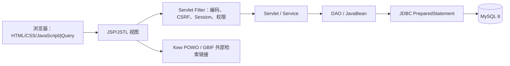

# 非粮油料植物知识检索与管理系统

## 1. 项目背景

课程资料以扫描 PDF 保存，植物名称、分类、形态描述、分布用途、图片和油料检测表格分散在多个页面。直接阅读和比较效率较低，OCR 也可能把植物标题、图像和表格列识别错位。

本项目将资料整理成可检索、可维护并保留来源的植物知识库。系统保留 PDF 页码和核验状态；不确定的描述和测量值不通过猜测补齐。

## 2. 技术架构

工程采用 Java 17 目标版本、Jakarta Servlet 6、JSP/JSTL、MySQL 8，面向 Tomcat 10.1。请求由 Servlet 接收，Service 校验业务数据，DAO 通过 JDBC 查询数据库，JavaBean 在业务层和页面间传递数据。前端继续使用 JSP、CSS、原生 JavaScript 与 jQuery，没有改用 React 或 Vue。

## 3. 功能模块

| 模块 | 主要功能 |
|---|---|
| 首页 | 数据概览、分类入口、植物精选、基础搜索和高级查询入口 |
| 植物检索 | 中文名、拉丁名、科属、别名和描述搜索；多条件及百分比范围过滤；结果字段选择、排序和分页 |
| 植物详情 | 图片、名称、分类、描述、分布、栽培、用途、来源页码、样本及核验状态 |
| 账户 | 注册、登录、个人资料、密码更新、收藏及退出 |
| 管理后台 | 植物与采样记录 CRUD、图片上传/删除、别名和科属维护、用户管理、审计记录 |
| 资料整理 | PDF 页码、OCR 原片段、图片裁切和油率/组分候选记录 |

## 4. 数据库设计

- `users` 保存账户摘要、启用状态和 `USER`/`ADMIN` 角色。
- `plant_families`、`plant_genera`、`plants` 表示科、属、植物层级。科属信息通过植物关联属记录取得。
- `plant_aliases` 保存别名；`plant_images` 保存图片路径、替代文本、来源页码和裁切来源。
- `plant_oil_samples` 表示植物的独立采样记录，含油率使用 `DECIMAL`，缺失值保留 `NULL`。
- `fatty_acid_components` 通过 `sample_id` 关联明确采样记录；组分百分比、单位、原始值和核验状态分开保存。
- `favorites` 使用用户和植物组合键；`audit_logs` 记录主要管理动作。

唯一键、外键、范围约束及索引由 MySQL 执行。来源导入使用稳定 `source_key`，避免重复生成同一条 PDF 记录。

## 5. 系统权限设计

- 游客可查看公开植物、基础检索和详情。
- 注册用户使用 Session 登录，可查看高级检索、维护个人资料并管理收藏。
- 管理后台由 `AdminFilter` 逐请求检查数据库中的账户启用状态和角色；普通用户得到 403。
- 全站 POST 使用 Session CSRF Token；登录时更新 Session，退出时销毁 Session。
- 管理员由一次性 CLI 初始化，不在代码或数据库脚本中提供固定默认密码。

## 6. 核心检索算法

检索条件由 Service 校验，DAO 生成参数化 SQL。用户输入只作为 `PreparedStatement` 参数传入；排序列和升降序只从固定白名单选择。分页以总数查询配合 `LIMIT` 和 `OFFSET` 返回。

含油率与脂肪酸条件都在同一个 `plant_oil_samples` 记录的 `EXISTS` 子查询内判断，组分再通过该记录的 `sample_id` 查询。这样不会把一个采样记录的含油率与另一条记录的脂肪酸拼接成假匹配。数值范围、数字关键词和含油率排序仅使用状态为 `VERIFIED` 的测量；未核验数字不能被当成确认结果。

## 7. 主要页面介绍

- **首页**：研究型视觉风格、主搜索、分类快捷入口和数据库实时统计。
- **检索页**：桌面端筛选区与结果区布局；窄屏筛选可折叠；支持字段配置、排序、分页、无结果提示和异常提示。
- **详情页**：名称和学名、图片、科属、分区描述、来源和外部链接；每条采样记录单独展示，含油率与组分的核验状态分开呈现。
- **登录/注册页**：统一表单、密码显示切换、客户端反馈和服务端错误提示。
- **管理员页面**：侧边导航、数据表单、采样编辑、图片预览和上传、危险操作确认及操作反馈。

## 8. 项目创新点

1. 识别结果带有 PDF 页码、原始片段、图片裁切框和核验状态，方便回到来源复查。
2. 植物条目、样本和化学组分分层保存，组合查询保证测量来自同一采样记录。
3. 把“采样记录状态”“含油率状态”“脂肪酸组分状态”分开，缺失值保留为空；不将单位不明的 OCR 数字推断成脂肪酸百分比。
4. 详情页提供 Kew POWO 和 GBIF 检索链接，并提供组分可视化界面。

## 9. 测试结果

- `mvn clean test`：22 项，19 项通过，3 项数据库测试因默认设置而跳过；无失败和错误。
- `./scripts/integration-test.sh`：3 项 MySQL 集成测试全部通过。
- `./scripts/business-flow-test.sh`：注册、登录、角色权限、搜索、收藏、管理员植物 CRUD、数值验证、图片上传/访问/删除、404 和退出均通过。
- `mvn package`：成功生成 `target/oil-plants-knowledge.war`。
- `./scripts/compile-jsps.sh`：JSP 编译 0 错误；`./scripts/smoke-test.sh`：嵌入式 Tomcat HTTP 冒烟通过。
- 当前 MySQL 实际数据：33 条植物、45 张图片、89 条采样记录、88 条已核验含油率、0 条已核验脂肪酸组分。

测试使用本机 Docker MySQL 和嵌入式 Tomcat。**项目尚未部署到独立 Tomcat 或服务器。**由于 PDF 原表没有足够证据确认脂肪酸列单位，当前没有可可靠展示的脂肪酸百分比图表数据。

## 10. 未来改进方向

- 通过人工复核原始表头和单位，逐条确认脂肪酸组分后再入库并启用非空图表。
- 部署到隔离测试环境和独立 Tomcat，执行完整移动端回归、并发测试、备份恢复和部署安全检查。
- 为正式使用配置 HTTPS、Secure/SameSite Cookie、登录速率限制、连接池、数据库备份和监控。
- 为植物分类和测量来源增加版本记录，支持批量审核及导入差异审查。
