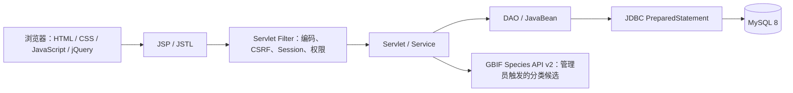

# PlantScope · 植知：植物知识探索与特征匹配平台

## 1. 项目背景

课程资料以 19 页扫描 PDF 保存，包含植物名称、分类、形态、分布用途、裁切图片和油料采样表。只用名称检索时，普通用户很难从外观找到植物；研究用户则需要按含油率和化学组分精确筛选。

PlantScope 保留课程 PDF 的来源和核验信息，提供“描述所见”“外观筛选”和专业检索三种入口。未知数据保持未知，不通过推测补齐。

## 2. 技术架构

项目采用 Java 17、Jakarta Servlet 6、JSP/JSTL、JDBC、MySQL 8，目标运行环境为 Tomcat 10.1。核心业务没有改为 Spring Boot、React 或 Vue。请求由 Servlet 接收，Service 做输入和业务校验，DAO 通过参数化 SQL 查询数据库，JavaBean 在层间传递数据。

## 3. 功能模块

| 模块 | 主要功能 |
|---|---|
| 首页与名录 | 主搜索、按科入口、数据库统计、真实数据驱动的精选与近期热门植物 |
| 描述找植物 | 中文口语词典和规则解析；显示并允许修改提取出的特征，不宣称是 AI |
| 外观特征检索 | 可跳过问题、支持否定条件；解释匹配依据、冲突、未知、分数和数据覆盖度 |
| 专业检索 | 名称/分类/描述、多条件组合、含油率/组分范围、同采样记录约束、分页和字段选择 |
| 综合植物类别 | `/categories` 按有来源确认的应用类别浏览；一株植物可以关联多个类别 |
| 详情与比较 | 植物来源和描述；对比 2–3 种植物，化学测量按样本分组 |
| 账户 | 图形验证码、邮箱验证/重置、登录失败数据库限流、认证日志、资料、收藏 |
| 用户历史 | 用户主动勾选保存搜索、本人最近浏览、可清理历史；热门访问按日汇总不记录 IP |
| 管理后台 | 植物/样本/图片与特征维护；脂肪酸、特征和外部分类候选审核；导入批次与扩容质量仪表盘 |

## 4. 数据库设计

- `users` 保存账户、角色、邮箱验证状态；`auth_email_challenges` 保存邮箱验证码摘要及期限；`auth_login_attempts`、`auth_events` 保存登录限流和认证事件。
- `plant_families`、`plant_genera`、`plants` 表示分类与植物；`plant_aliases`、`plant_images` 管理别名与图片。
- `plant_oil_samples` 是样本事实边界；`fatty_acid_components.sample_id` 将组分绑定到单一采样记录。缺失的数值使用 `NULL`，油率、组分与样本状态各自记录。
- `trait_categories`、`plant_traits`、`trait_options` 建立稳定编码的特征词表；`plant_trait_values` 保存植物特征、来源证据、状态与审核信息；`plant_knowledge_sources` 保存来源。
- `fatty_acid_candidates` 把未确认单元格与具体 `sample_id` 隔离；人工核验后才进入正式 `fatty_acid_components`。`external_taxon_candidates` 保存 GBIF 原始响应，`knowledge_review_events` 追加审核和语义修正事件。
- 3.2 新增 `plant_categories` / `plant_category_relations`（应用类别多对多）、`plant_datasets` / `plant_dataset_relations`（数据集关系）、分类参考、外部 namespace ID、来源知识条目、图片引用和外部导入批次/候选/审核表。原课程数据关联到 `COURSE_ORIGINAL`，没有复制植物行。
- `user_search_history` 与 `user_plant_history` 由用户外键隔离；`plant_daily_views` 仅累计每日植物浏览量，不保留访客 IP。
- 课程 PDF 数据通过稳定来源键导入；所有新增迁移是增量迁移。

**数据现状（2026-10-11 实时数据库）：**33 株课程植物、45 张关联图、89 条采样记录、88 条已核验含油率；正式脂肪酸组分 0，另有 97 个待审核单元格；外观候选 94 条、确认 0。新增 GBIF 候选 3 条仍待核验；GENERAL_BOTANY 已发布植物 0。当前不能声称可以可靠识别真实植物，也没有达到建议的约 150 种。

## 5. 系统权限设计

- 游客可浏览公开植物、基础检索、描述搜索、外观检索和公开对比。
- 登录用户可进行专业检索、收藏、资料与历史管理；搜索历史只有勾选保存后才会写入，最近浏览和清理操作按账户隔离。
- 普通用户不能进入管理员 Servlet；管理员 Filter 在服务端读取账户角色和启用状态。
- 注册/登录需通过 Session 绑定的一次性图形验证码；注册、邮箱绑定与密码重置使用限时、限尝试、一次性邮箱码。数据库不保存验证码明文。
- POST 由 CSRF Filter 保护；密码以 BCrypt 保存。SMTP 密钥和邮件摘要密钥由环境变量提供。仅在显式本地开发模式且配置邮箱目录时才使用本地邮件模拟。

## 6. 核心检索算法

### 专业检索

Service 校验输入后构建 SQL 条件，DAO 使用 `PreparedStatement`。排序字段来自固定白名单。分页通过总数查询与 `LIMIT/OFFSET` 完成。含油率和组分过滤在同一 `plant_oil_samples` 记录下判断，再通过该行 `sample_id` 关联化学组分，避免跨样本组合。

### 外观特征匹配

用户特征与受控的 trait/option 编码对齐。只读取 `CONFIRMED` 证据；明确匹配加权、明确冲突降低排序值，未知/待核验/有争议项分别解释且不自动作为冲突。结果显示启发式匹配分数和数据覆盖度，分数不是识别概率。当前确认特征为空，页面说明证据不足。

### 自然语言规则

有限词典将“像针”“小扇子”“秋天变黄”等表达映射到候选特征编码，处理有限否定表达。用户可以在提交前修正条件。该方案是词典和规则匹配，不是完整语义理解或 AI。

## 7. 主要页面

- 首页突出输入框，并提供描述、外观和专业检索入口。
- 植物检索页在桌面使用筛选与结果区，移动端筛选折叠；提供字段配置和数据库联想。
- 描述/外观页以可跳过的条件选择和可编辑解析结果为中心，显示证据不足状态。
- 详情展示分类、图片、形态、分布、用途、来源和独立采样数据。
- 植物对比页支持两到三项；移动端结果表格在容器内横向滚动，不拼接样本。
- 账户与管理页面共用 PlantScope 视觉变量；管理员可以维护来源和待核验特征。
- 分类浏览页从数据库读取确认类别关系；扩容工作台显示实时数据统计、外部候选字段、批次、逐条审核决定和受限撤回理由。

## 8. 项目创新点

1. 把名称搜索扩展到描述式和外观式探索，同时保留面向研究者的严谨数值查询。
2. 匹配展示证据、未知和冲突，并区分启发式排序与数据覆盖，不伪称识别概率。
3. 组分严格绑定采样记录，核验状态与缺失值分开处理。
4. 数据源和页码可以追溯；外部知识采用人工审核，不自动覆盖课程事实。
5. 用户搜索历史需主动选择保存；最近浏览按账户隔离，热门统计只作 30 日汇总且不记录 IP。

## 9. 测试结果

- 3.2 `mvn clean test`：45 项，0 失败，10 个数据库集成测试在默认配置下跳过；`mvn package` 成功生成 `target/oil-plants-knowledge.war`。
- MySQL 集成测试在恢复出的临时 schema 上 10/10 通过；嵌入式 Tomcat + MySQL HTTP 业务流程通过，包括游客/用户/管理员、类别分页、权限、真实候选队列入口、搜索、管理 CRUD 和退出。
- `./scripts/compile-jsps.sh`：JSP Jasper 编译 0 错误；Python 数据处理单测 12/12；Node.js 语法检查和 `git diff --check` 通过。
- 本轮实际从 GBIF strict-name endpoint 获取 3 个候选并导入主库，dry-run 和 commit 成功；候选全部待核验，没有写入正式植物或分类引用。
- 3.0 期间曾用 Chrome 检查首页与检索页多个视口；本轮没有在真实浏览器重新检查 3.2 类别页/扩容工作台各视口。未使用真实 SMTP、未部署独立 Tomcat，也未完成并发、压力、渗透或生产恢复演练。

完整 3.2 证据见 [TEST_REPORT_3_2.md](TEST_REPORT_3_2.md)、[ACCEPTANCE_REPORT_3_2.md](ACCEPTANCE_REPORT_3_2.md) 与 [DATA_QUALITY_REPORT_3_2.md](DATA_QUALITY_REPORT_3_2.md)。3.0 历史验收记录保留在 [TEST_REPORT_3_0.md](TEST_REPORT_3_0.md)。

## 10. 未来改进方向

- 从可靠来源人工审核并录入外观特征，扩大真实候选覆盖度。
- 增加带用户授权的植物观察记录与图片上传，位置仅用自愿填写的粗粒度区域。
- 补充已接受外部学名与历史名称的独立映射/修订记录；只在接口与授权核实后接入 POWO/WFO。
- 若未来接入大模型或图像识别，应作为可关闭的独立模块，不影响基础规则检索。
- 进行完整表单/管理页浏览器回归，并测试 SMTP、独立 Tomcat、安全配置、压力和备份恢复。
